<p align="center">
  
</p>

---

### About

Backend and infrastructure engineer. I like **orchestration**: making many moving parts behave as one system.

By day: Software Engineer, Infrastructure at **Gameloft** in Sofia, on the backend services that run game servers for live titles (Go, C++ and Python on Kubernetes with Agones).<br/>
By night: co-founder of **Workmatic**, where I own the architecture and backend our LLM agents run on.

Before that I worked on the job scheduler of a cloud-provisioning platform at **AOSSIA Healthcare**.

---

### What I'm working on

```yaml
Argus:                      # Workmatic's invoice-processing pilot
  flow: "invoice -> extraction -> six checks -> proposed double-entry posting -> accountant confirms"
  checks: [VAT, document type, company ID, duplicates, arithmetic, anomalies]
  backend: "Node.js, with a model layer that retries and falls back across LLM providers"
  exports: "18 adapters, including NetSuite and SAF-T"
  tests: "117 integration tests"
  inference: "self-hosted Qwen and Llama for data that has to stay on premises"
```

---

<p align="center">
  <b>Languages</b><br/>
  
  
  
  
  
  
  
  
</p>

<p align="center">
  <b>Infrastructure</b><br/>
  
  
  
  
  
  
</p>

<p align="center">
  <b>AI / LLM</b><br/>
  
  
  
  
  
</p>

<br/>

## 🚀 Featured

<p align="center">
  <a href="https://github.com/PKBurov/beeper-chat-summarizer"></a>
  <a href="https://github.com/PKBurov/fmi-coursework"></a>
  <a href="https://github.com/PKBurov/tu-coursework"></a>
  <a href="https://github.com/PKBurov/personal-projects"></a>
</p>

---

<p align="center">
  <a href="https://www.linkedin.com/in/petar-burov-742abb354">LinkedIn</a> · <a href="mailto:pkburov@gmail.com">Email</a> · <a href="https://github.com/PKBurov">GitHub</a>
</p>
