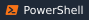
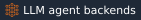

I'm a backend and infrastructure engineer, and the part I like most is **orchestration**: getting many moving parts to behave as one system.

At **Gameloft** that is the backend that game servers for live titles run on: Go, C++ and Python on Kubernetes with Agones. At **Workmatic**, which I co-founded, it is the architecture and backend our LLM agents run on.

### Now running

### Toolbox

<table>
  <tr>
    <td><b>Languages</b></td>
    <td>
      
      
      
      
      
      
      
      
      
    </td>
  </tr>
  <tr>
    <td><b>Infrastructure</b></td>
    <td>
      
      
      
      
      
      
    </td>
  </tr>
  <tr>
    <td><b>AI</b></td>
    <td>
      
      
      
      
      
    </td>
  </tr>
</table>

### Projects

- [beeper-chat-summarizer](https://github.com/PKBurov/beeper-chat-summarizer): a fully local chat summarizer for Beeper. It connects Beeper's MCP server to n8n, Postgres and Ollama, so messages never leave the machine.

### Reach me

